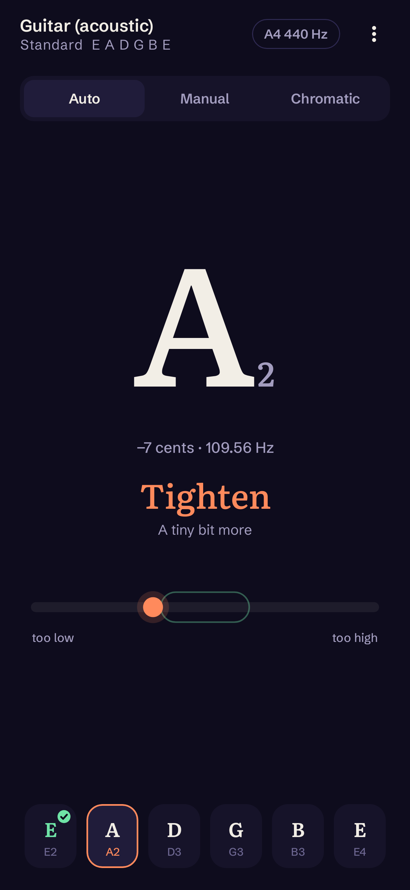
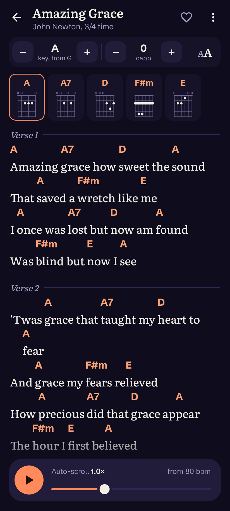
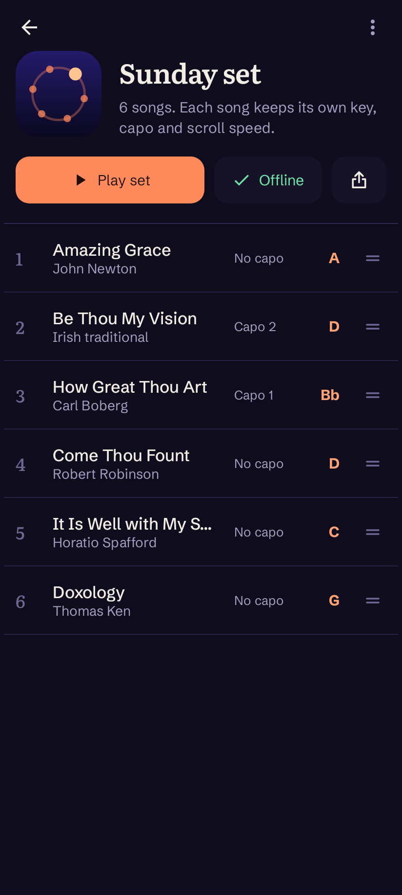
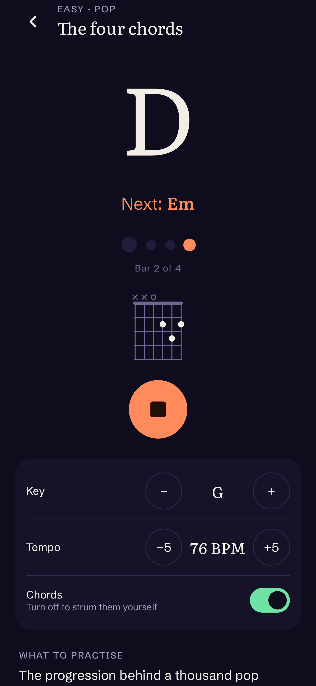

<h1 align="center">OrbitTuner</h1>

<p align="center">
  <a href="LICENSE"></a>
  
  
  
</p>

<p align="center">
  <b>An open-source guitar tuner, chord sheets, voice song search and practice backing tracks for Android phones and tablets.</b>
</p>

<p align="center">
  
  
  
  
</p>

---

> **Part of the Orbit family**: open-source apps that keep your data on your own devices. Read more at **[orbitapps.space](https://orbitapps.space)**.

## Features

**Tuner**
- 24 instruments, from guitar, bass and ukulele to violin, mandolin, oud and shamisen, each with its common tunings, plus a chromatic mode.
- Auto, Manual and Chromatic modes. A beginner-friendly meter (Tighten / Loosen / Perfect) or a classic dial.
- Adjustable reference pitch (A4 = 415 to 466 Hz), letter or Do-Re-Mi note names, sharps or flats.
- Works offline. Tuning audio never leaves the phone.

**Songs and chords**
- Search songs by title, artist or lyrics, filtered by language and category.
- A clean song view: transpose, capo, chord diagrams (guitar, ukulele, piano) and auto-scroll at the song's own pace.
- Favourites, playlists and set lists. Each song keeps its own key, capo and scroll speed, and playlists can be saved for offline use.
- Add songs by pasting text, pasting a link to a chord page, or writing them in ChordPro. The song service can tidy pasted or linked sheets into ChordPro with AI.

**Sing a line** (beta)
- Sing a line or say a song's name, and OrbitTuner finds it and moves it to the key you sang in.

**Practice tools**
- A metronome with tap tempo and accents.
- Backing tracks: graded lessons where a band plays the chords and waits for you, in any key and tempo.

## The song library is not included

This repository contains the app and the song service code only. **It ships no song library.** A new service starts empty, apart from six public-domain hymns you can load as samples. You import your own songs (ChordPro, text files or a zip) through the service's portal or the app.

## Getting OrbitTuner

<p align="center">
  <a href="https://github.com/Kno2gether-Labs-LTD/orbittuner/releases/latest/download/OrbitTuner.apk"></a>
</p>

**[Download the latest APK](https://github.com/Kno2gether-Labs-LTD/orbittuner/releases/latest/download/OrbitTuner.apk)** (Android 10+), or see all versions under [Releases](https://github.com/Kno2gether-Labs-LTD/orbittuner/releases). Open the file on your phone and allow your browser or Files app to install it; Play Protect may warn you because the app isn't from the Play Store.

Every release is signed with the same key, so updates install over the previous version. The SHA-256 checksum of each APK is attached to its release.

### Build it yourself

```bash
# Requirements: JDK 17+, Android SDK 35
./gradlew :app:testDebugUnitTest
./gradlew :app:assembleDebug
adb install app/build/outputs/apk/debug/app-debug.apk
```

The app talks to the song service named by `SERVICE_HOST` in `app/build.gradle.kts`. Point it at your own service there; debug builds can also change it in Settings → Developer. Release builds read their signing key from `~/.gradle/gradle.properties` (`ORBITTUNER_RELEASE_*` or `ORBIT_RELEASE_*`); without one they stay unsigned. Google sign-in is optional and needs `ORBITTUNER_GOOGLE_WEB_CLIENT_ID` there too.

## Self-hosting the song service

The service in [`service/`](service) is a Cloudflare Worker (TypeScript, Hono) with D1 for data, R2 for files, a Queue for link imports and Workers AI for Sing a line. It serves the app's API (`/v1/...`) and an owner portal (`/portal`).

```bash
cd service
npm ci
npm test && npm run typecheck

npx wrangler login
npx wrangler d1 create orbittuner          # paste the printed database_id into wrangler.jsonc
npx wrangler r2 bucket create orbittuner-files
npx wrangler queues create orbittuner-import
npx wrangler d1 migrations apply orbittuner --remote
```

Then, in `wrangler.jsonc`, change `routes` and `PUBLIC_HOST` to your own domain, set the secrets and deploy:

```bash
printf '%s' "$VALUE" | npx wrangler secret put SETUP_TOKEN   # one-time owner setup link
npx wrangler deploy
```

Secrets, by name: `SETUP_TOKEN` (required), `SECRETS_KEY` (encrypts keys saved in the portal), and optionally `INWORLD_API_KEY`, `OPENAI_API_KEY` (AI conversion and Sing a line) and `APIFY_TOKEN` (web search and sites that block direct fetches). Open `https://<your domain>/portal/setup?token=<SETUP_TOKEN>` once to create the owner account, then import your songs.

[service/README.md](service/README.md) covers local development, backups, limits, AI import and Sing a line in detail.

## Project layout

| Path | What's inside |
|---|---|
| `app/` | The Android app (Kotlin, Jetpack Compose): tuner DSP, song view, library, voice search, metronome and backing tracks |
| `service/` | The song service (Cloudflare Worker): API, portal, ChordPro tools, AI import and voice search |
| `docs/design/` | The approved mockup and app screenshots |

## Built by Kno2gether Labs

OrbitTuner and the Orbit family are designed and built by **[Kno2gether Labs LTD](https://kno2gether.com)**, the team behind **[Knotie](https://knotie-ai.pro)**. If you'd like something built, get in touch at [kno2gether.com](https://kno2gether.com).

## Contributing

Thank you for the interest! **Contributions aren't open yet**: pull requests can't be reviewed for now. Feedback is very welcome: open an issue. See [CONTRIBUTING.md](CONTRIBUTING.md).

To report a security problem privately, see [SECURITY.md](SECURITY.md).

## License

[Apache-2.0](LICENSE). Third-party components are listed in [NOTICE](NOTICE).

OrbitTuner is an independent project, not affiliated with or endorsed by any other tuner, chord or music app, or any chord website. Product names are trademarks of their owners.
